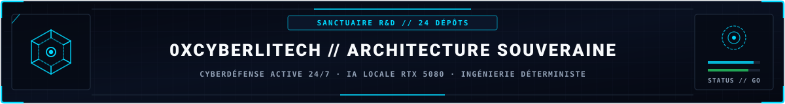
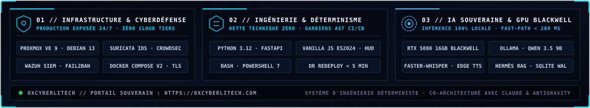

<!-- MASTER-HEADER-START -->

  
  
  
  

  

<!-- MASTER-HEADER-END -->

#  CHANGELOG - 0xCyberLiTech

Ce dépôt est un laboratoire personnel de connaissances et d’expériences en cybersécurité et informatique.  
Il vise à **prendre, s’approprier, et redistribuer** le savoir acquis, pour le partage et la contribution à la communauté.
---

##  [v1.0.0] - 2025-07-17

###  Départ du laboratoire
- Mise en place des premiers scripts et outils de sécurité :
  - Audit réseau, antivirus, détection de rootkits, audits système
- Organisation claire des dossiers et fichiers pour une meilleure compréhension

##  [v1.1.0] - 2025-08-21

###  Sécurisation et organisation

- Ajout d’un fichier `.gitignore` pour renforcer la sécurité et éviter la publication de fichiers sensibles ou inutiles
- Vérification et organisation des dépôts publics
- Mise en place de bonnes pratiques pour la gestion des fichiers et dossiers

##  [v1.2.0] - 2025-08-24

###  Documentation et organisation

- Refactorisation du fichier README.md pour plus de clarté et une meilleure organisation
- Mises à jour successives du README.md pour améliorer la présentation et l’information
- Fusion et organisation des branches principales

##  Objectifs futurs

- Enrichir ce laboratoire avec de nouveaux outils et scripts
- Continuer à apprendre, tester et améliorer les solutions proposées
- Partager des tutoriels, guides, et retours d’expérience
- Créer une communauté active autour de ces ressources
- Favoriser la pédagogie et la sécurité accessible à tous

---

##  Historique

- Création du projet : juin 2025  
- Première version publique : juillet 2025

<!-- MASTER-FOOTER-START -->

<b>Architecturé &amp; Forgé par Marc &amp; Antigravity (Google DeepMind)</b> &nbsp;·&nbsp; <a href="https://0xcyberlitech.com/"><b>0xcyberlitech.com</b></a> &nbsp;·&nbsp; <a href="https://0xcyberlitech.com/soc-rd.html">Architecture SOC Cockpit v5.5</a> &nbsp;·&nbsp; <a href="https://0xcyberlitech.com/jarvis-rd.html">Architecture JARVIS Mark-VII</a> &nbsp;·&nbsp; <a href="https://0xcyberlitech.com/blueprint-jarvis.html">Blueprint Matériel RTX 5080</a>

<!-- MASTER-FOOTER-END -->
