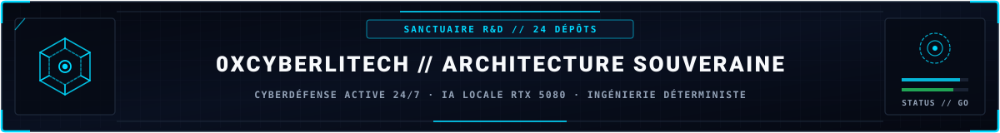
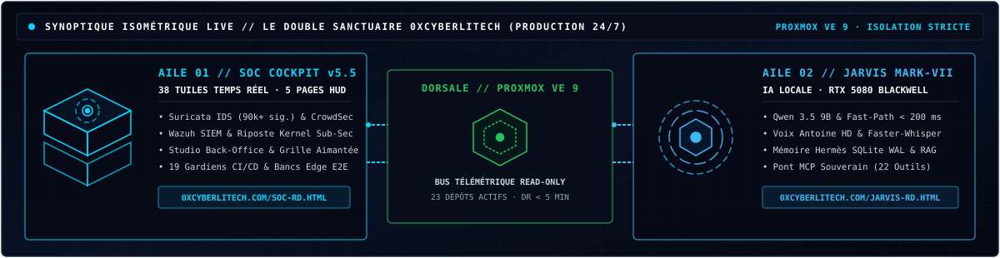
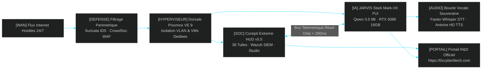
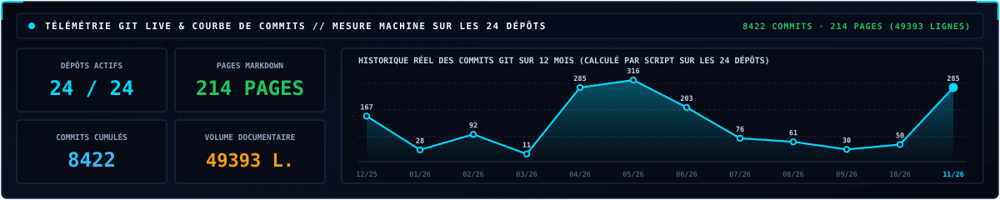
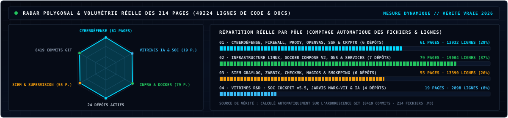
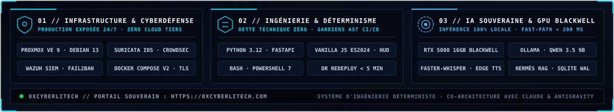

<!-- MASTER-HEADER-START -->

  
  
  
  

<!-- MASTER-HEADER-END -->

---

##  01 // LE DOUBLE SANCTUAIRE R&D (PRODUCTION 24/7)

> *"On n'apprend pas la cybersécurité en lisant. On l'apprend en défendant une infrastructure réelle exposée 24h/24 aux attaques d'Internet."*

Chaque brique présentée sur ce profil tourne en **production réelle 24h/24 et 7j/7** sur une dorsale **Proxmox VE 9** souveraine, sans aucun cloud tiers, gouvernée par une discipline d'**ingénierie déterministe (Dette Technique Zéro)**. Les dossiers d'architecture complets et blueprints matériels sont publiés sur le portail officiel **[0xcyberlitech.com](https://0xcyberlitech.com/)**.

| Sanctuaire | Architecture & Spécifications Clés | Portail R&D (`0xcyberlitech.com`) | Dépôt & Tuto GitHub |
|:---|:---|:---:|:---:|
| [**SOC COCKPIT**](https://github.com/0xCyberLiTech/SOC) *Extreme HUD v5.5* | **38 tuiles télémétriques temps réel** sur 5 pages · **Suricata IDS** (90k+ sig.) · **CrowdSec WAF** · **Wazuh SIEM** · Riposte noyau `< 1 s` · **Studio Back-Office** · **19 Gardiens CI/CD** | [**Livre Blanc SOC →**](https://0xcyberlitech.com/soc-rd.html) | [**Dépôt GitHub SOC →**](https://github.com/0xCyberLiTech/SOC)  |
| [**JARVIS MARK-VII**](https://github.com/0xCyberLiTech/JARVIS) *Orchestrateur IA Local* | **Qwen 3.5 9B** sur **RTX 5080 16 Go Blackwell** · **Fast-Path déterministe `< 200 ms`** · Voix neurale **Antoine HD** & **Faster-Whisper** · Mémoire **Hermès SQLite WAL & RAG** · **Pont MCP (22 outils)** | [**Livre Blanc JARVIS →**](https://0xcyberlitech.com/jarvis-rd.html) [**Blueprint RTX 5080 →**](https://0xcyberlitech.com/blueprint-jarvis.html) | [**Dépôt GitHub JARVIS →**](https://github.com/0xCyberLiTech/JARVIS)  |

---

<b>[SYNOPTIQUE INTERACTIF] Ouvrir le Graphe d'Architecture (Technologie GitHub Mermaid Zoom/Pan)</b>

---

##  02 // CARTOGRAPHIE 3D DES CONTRIBUTIONS & TÉLÉMÉTRIE D'INGÉNIERIE

  

  

---

##  03 // CATALOGUE DES ATELIERS TECHNIQUES & RUNBOOKS (DEBIAN 12 · 13 · 14)

L'ensemble des procédures d'infrastructure, de durcissement et de supervision ci-dessous est maintenu selon le principe de **Vérité Vraie** (`Debian 12 Bookworm · Debian 13 Trixie · Debian 14 Forky`, `Docker Compose v2`, `systemd`, `nftables`/`ufw`).

| Domaine | Atelier Technique | Périmètre Opérationnel & Technologies | Dossiers | Accès Direct |
|:---|:---|:---|:---:|:---:|
| **SANCTUAIRE R&D** | [**JARVIS Mark-VII**](https://github.com/0xCyberLiTech/JARVIS) | Orchestrateur IA souverain Qwen 3.5 9B (RTX 5080 Blackwell), Fast-Path `< 200 ms`, Voix & RAG | `Vitrine` |  |
| **SANCTUAIRE R&D** | [**SOC Cockpit v5.5**](https://github.com/0xCyberLiTech/SOC) | Poste de commandement Cyberdéfense 38 tuiles, Suricata IDS, CrowdSec WAF, Wazuh SIEM | `Vitrine` |  |
| **CYBERDÉFENSE** | [**Cybersécurité**](https://github.com/0xCyberLiTech/Cybersecurite) | Durcissement Debian 12, 13 & 14, Suricata 7 IDS/IPS, CrowdSec ipset noyau, sécurisation | `18` |  |
| **CYBERDÉFENSE** | [**Firewall**](https://github.com/0xCyberLiTech/Firewall) | Filtrage réseau Netfilter, `nftables` Zero-Trust, `ufw`, `iptables`, cloisonnement DMZ/VLAN | `4` |  |
| **CYBERDÉFENSE** | [**Proxy**](https://github.com/0xCyberLiTech/Proxy) | Filtrage HTTP/HTTPS avec Squid Proxy, SSL Bump, HAProxy sous Debian 12, 13 & 14 | `9` |  |
| **CYBERDÉFENSE** | [**OpenVAS**](https://github.com/0xCyberLiTech/OpenVAS) | Scanner de vulnérabilités Greenbone (GVM), audit CVE & remédiation | `7` |  |
| **CYBERDÉFENSE** | [**SSH**](https://github.com/0xCyberLiTech/SSH) | Bastion OpenSSH, authentification par clés Ed25519, tunnels sécurisés | `3` |  |
| **CYBERDÉFENSE** | [**Cryptographie**](https://github.com/0xCyberLiTech/Cryptographie) | Chiffrement symétrique/asymétrique, PKI X.509, certificats TLS OpenSSL | `2` |  |
| **SIEM & NOC** | [**Graylog**](https://github.com/0xCyberLiTech/Graylog) | Centralisation SIEM des journaux Linux/Windows, pipelines et dashboards | `13` |  |
| **SIEM & NOC** | [**Zabbix**](https://github.com/0xCyberLiTech/Zabbix) | Supervision d'infrastructure Zabbix Server & Agents, triggers et alertes | `10` |  |
| **SIEM & NOC** | [**Checkmk**](https://github.com/0xCyberLiTech/Checkmk) | Monitoring multi-nœuds haute précision, agents Linux/Windows et règles | `2` |  |
| **SIEM & NOC** | [**Nagios**](https://github.com/0xCyberLiTech/Nagios) | Supervision réseau Nagios Core, plugins NRPE et contrôles de services | `10` |  |
| **SIEM & NOC** | [**Smokeping**](https://github.com/0xCyberLiTech/Smokeping) | Métrologie WAN, mesure de latence/jitter ICMP et graphes RRD | `1` |  |
| **SIEM & NOC** | [**Supervision**](https://github.com/0xCyberLiTech/Supervision) | Fondamentaux d'observabilité NOC/SOC, protocoles SNMP et architecture | `1` |  |
| **INFRA & VIRTUALISATION** | [**Proxmox VE 8 & 9**](https://github.com/0xCyberLiTech/Proxmox) | Montage Bare-Metal BIOS/UEFI, ZFS, LVM-Thin, KVM (`qm`), LXC (`pct`), Pare-feu PVE, Sauvegardes PRA (`vzdump`/PBS) & Cluster HA | `10` |  |
| **INFRA & CONTENEURS** | [**Docker**](https://github.com/0xCyberLiTech/Docker) | Conteneurisation Docker Engine, `docker compose` v2, Portainer, réseaux/volumes | `23` |  |
| **INFRA & RÉSEAU** | [**DNS (BIND9)**](https://github.com/0xCyberLiTech/DNS) | Serveurs DNS Maître/Esclave BIND9, zones directes/inverses Debian 12, 13 & 14 | `4` |  |
| **INFRA & RÉSEAU** | [**DHCP**](https://github.com/0xCyberLiTech/DHCP) | Attribution dynamique IP, réservations MAC et segmentation sous Debian | `4` |  |
| **INFRA & RÉSEAU** | [**NTPsec**](https://github.com/0xCyberLiTech/NTPsec) | Synchronisation horaire atomique sécurisée pour corrélation forensique | `1` |  |
| **WEB & DATA** | [**Apache2 / LAMP**](https://github.com/0xCyberLiTech/Apache2) | Stack Web Debian (Apache2, PHP, MariaDB), VirtualHosts SSL/TLS | `7` |  |
| **WEB & DATA** | [**MySQL / MariaDB**](https://github.com/0xCyberLiTech/MySQL) | Administration SGBD relationnel, durcissement des accès et sauvegardes | `1` |  |
| **IA & SYSTÈME** | [**IA Souveraine**](https://github.com/0xCyberLiTech/IA) | Ollama GPU Blackwell, Qwen 3.5 9B, RAG SQLite-vec, Whisper CUDA TTS & architectures GPU/NPU | `11` |  |
| **IA & SYSTÈME** | [**Astuces Linux**](https://github.com/0xCyberLiTech/Astuces) | Runbooks d'administration système, diagnostic CLI et automatisation | `7` |  |

<!-- MASTER-FOOTER-START -->

<b>Architecturé &amp; Forgé par Marc &amp; Antigravity (Google DeepMind)</b> &nbsp;·&nbsp; <a href="https://0xcyberlitech.com/"><b>0xcyberlitech.com</b></a> &nbsp;·&nbsp; <a href="https://0xcyberlitech.com/soc-rd.html">Architecture SOC Cockpit v5.5</a> &nbsp;·&nbsp; <a href="https://0xcyberlitech.com/jarvis-rd.html">Architecture JARVIS Mark-VII</a> &nbsp;·&nbsp; <a href="https://0xcyberlitech.com/blueprint-jarvis.html">Blueprint Matériel RTX 5080</a>

<!-- MASTER-FOOTER-END -->
